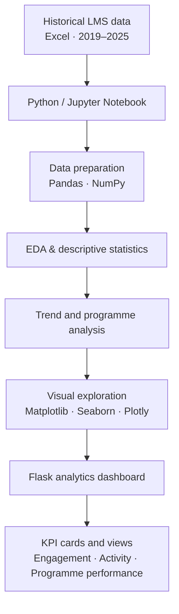

# ICT Paatshala LMS Analytics

### Data Science & Analytics · Internship Case Study

**A confidentiality-safe overview of an LMS analytics project completed during an IT Solution Internship at ICT Academy of Kerala.**

---

> **Confidentiality note:** This repository documents project scope, analytical workflow, and high-level solution design only. It does not contain organisational datasets, internal dashboard screenshots, company-specific KPI values, or detailed internal findings.

## Project at a glance

| | |
|---|---|
| **Project domain** | Learning Management System (LMS) analytics |
| **Professional context** | IT Solution Intern — Data Science & Analytics |
| **Historical period analysed** | 2019–2025 |
| **Input format** | Excel files |
| **Analysis environment** | Python in Jupyter Notebook |
| **Presentation layer** | Flask-based analytics dashboard |

## Overview

The project focused on preparing historical LMS data for analysis and exploring indicators related to learner engagement and programme performance. The workflow covered data preparation, exploratory data analysis (EDA), descriptive statistics, time-based trend exploration, programme comparisons, and dashboard presentation.

The dashboard brought selected indicators and visual views into one place so stakeholders could review patterns and identify areas for further investigation. This public case study describes the approach without disclosing confidential results.

## Analytical workflow

## What the work covered

<strong>01 · Data preparation</strong>

- Worked with historical Excel-based LMS data.
- Used Python, Pandas, and NumPy for data cleaning and manipulation.
- Performed data-quality checks appropriate to the available fields.
- Prepared data for exploratory and descriptive analysis.

<strong>02 · Exploratory and trend analysis</strong>

- Performed EDA and descriptive statistics, including mean, median, and mode where appropriate.
- Explored monthly and yearly enrolment, dropout, and course-completion patterns.
- Investigated changes around the COVID-19 period.
- Examined relationships between selected indicators, including enrolment and completion.

<strong>03 · Programme and engagement analysis</strong>

- Compared programme-level enrolment, completion, and dropout indicators.
- Explored learner activity and assignment-submission information.
- Considered how the indicators could help stakeholders review engagement and programme performance.

<strong>04 · Dashboard presentation</strong>

- Developed a Flask-based analytics dashboard.
- Presented KPI cards and views for monthly/yearly trends, learner activity, assignment submissions, engagement, and programme performance.

## Technology stack

| Workstream | Tools |
|---|---|
| Programming and analysis | Python, Jupyter Notebook |
| Data cleaning and manipulation | Pandas, NumPy |
| Exploratory analysis and descriptive statistics | Python, Pandas, NumPy |
| Data visualisation | Matplotlib, Seaborn, Plotly |
| Web application / dashboard | Flask |

## Business questions explored

- How did enrolment, dropout, and course-completion patterns vary by month and year?
- What changes were visible around the COVID-19 period?
- How did selected enrolment and completion indicators move in relation to one another?
- How did programmes compare across enrolment, completion, and dropout indicators?
- What could learner activity and assignment-submission information contribute to an engagement review?
- How could selected indicators be presented together for easier stakeholder review?

These are questions explored in the project, not published findings. Actual values and organisation-specific conclusions are not included.

## Intended business use

The dashboard consolidated selected indicators and visualisations to support review of learner engagement and programme performance. It was intended to make patterns easier to inspect and support data-informed discussion.

**No quantified business impact is claimed in this repository.** Actual results are not published because the underlying data and dashboard are confidential.

## Repository guide

| File | Purpose |
|---|---|
| [`docs/project-methodology.md`](docs/project-methodology.md) | Data preparation, analysis, and visualisation workflow |
| [`docs/business-questions.md`](docs/business-questions.md) | Analytical questions and interpretation principles |
| [`docs/solution-architecture.md`](docs/solution-architecture.md) | High-level architecture and workflow diagram |
| [`docs/confidentiality.md`](docs/confidentiality.md) | Public sharing boundaries |
| [`docs/interview-notes.md`](docs/interview-notes.md) | Concise interview explanation |

## Interview-ready summary

> During my IT Solution Internship in Data Science & Analytics at ICT Academy of Kerala, I worked on ICT Paatshala LMS Analytics using historical Excel-based data covering 2019–2025. I used Python in Jupyter Notebook, Pandas, and NumPy for data preparation and used Matplotlib, Seaborn, and Plotly for exploratory and trend analysis. The work covered enrolment, dropout, course completion, learner engagement, assignment submissions, and programme performance. I also developed a Flask-based dashboard to present selected KPIs and trends. The underlying data and internal dashboard are confidential, so this repository shares only a high-level case study.

## Confidentiality checklist

- No original or derived company datasets are included.
- No student, learner, trainer, or programme identifiers are included.
- No actual company KPI values, detailed internal findings, or internal reports are published.
- No internal dashboard screenshots, private URLs, credentials, or secrets are included.

Before publishing, confirm that the project description and technology details are permitted under applicable internship and organisational policies. Do not add internal material without explicit authorisation.

---

**Professional case study · No confidential data included**

