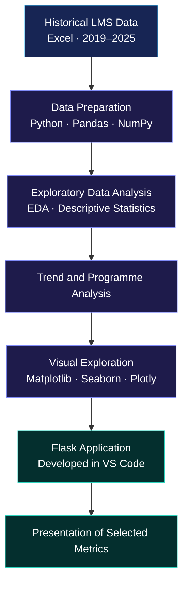

 

  

  

**A Data Science & Analytics case study**  
*Learning Management System · Historical Trends · Learner Engagement · Programme Performance*

 

---

### ◈ FROM RAW DATA TO ANALYTICAL INSIGHTS ◈

**Data Preparation → Exploratory Analysis → Trend Investigation → Visualisation → Application Development**

> [!IMPORTANT]
> This public repository is a confidentiality-safe case study. Organisational datasets, learner identifiers, internal dashboard screenshots, confidential KPI values, and organisation-specific findings are not published.

## 

An applied Data Science & Analytics project completed during an **IT Solution Internship at ICT Academy of Kerala**, focused on exploring historical Learning Management System (LMS) data.

<table>
<tr>
<td width="50%" valign="top">

### ◈ Project Profile

| Attribute | Details |
|---|---|
| Domain | LMS Analytics |
| Role | IT Solution Intern — Data Science & Analytics |
| Analysis period | 2019–2025 |
| Source format | Excel files |
| Programming | Python |
| Analysis environment | Jupyter Notebook |
| Development environment | Visual Studio Code |
| Application framework | Flask |

</td>
<td width="50%" valign="top">

### ◈ Analytical Focus

- Learner enrolment trends
- Course completion and dropout indicators
- Programme-level comparisons
- Learner activity and assignment submissions
- Historical and COVID-era patterns
- Descriptive statistics and visual exploration

</td>
</tr>
</table>

---

## 

---

## 

| Layer | Technologies | Purpose |
|---|---|---|
| Programming | Python | Data analysis and manipulation |
| Notebook analysis | Jupyter Notebook | Exploratory analysis and statistical investigation |
| Data preparation | Pandas, NumPy | Cleaning and transformation |
| Visualisation | Matplotlib, Seaborn, Plotly | Statistical plots and trend visualisation |
| Development | Visual Studio Code | Flask application development |
| Application framework | Flask | Web-based analytics presentation |

---

## 

<strong>◈ 01 — Data preparation</strong>

- Prepared historical Excel-based LMS data for analysis.
- Used Pandas and NumPy for cleaning and manipulation.
- Performed data-quality checks appropriate to the available fields.
- Organised data for exploratory and descriptive analysis.

<strong>◈ 02 — Exploratory data analysis</strong>

- Examined data distributions and descriptive statistics.
- Used mean, median, and mode where appropriate.
- Explored monthly and yearly enrolment, dropout, and completion patterns.
- Investigated changes around the COVID-19 period.

<strong>◈ 03 — Programme and engagement analysis</strong>

- Compared selected programme-level indicators.
- Explored learner activity and assignment-submission information.
- Investigated patterns relevant to engagement and programme performance.
- Considered how the indicators could support stakeholder review.

<strong>◈ 04 — Application development</strong>

- Developed a Flask-based analytics application.
- Used Visual Studio Code as the development environment.
- Presented selected metrics and trends in a consolidated interface.

---

## 

- How did enrolment, dropout, and completion patterns vary over time?
- What changes were visible around the COVID-19 period?
- How did programmes compare across selected indicators?
- What could learner activity and assignment submissions contribute to engagement analysis?
- How could selected metrics be presented together to support stakeholder review?

These questions describe the analytical scope, not published findings.

---

## 

| Document | Purpose |
|---|---|
| [Project Methodology](docs/project-methodology.md) | Data preparation and analytical workflow |
| [Business Questions](docs/business-questions.md) | Analytical questions and interpretation |
| [Solution Architecture](docs/solution-architecture.md) | High-level architecture |
| [Confidentiality Guidelines](docs/confidentiality.md) | Public sharing boundaries |

---

## 

- No original or derived organisational datasets are published.
- No learner, student, trainer, or programme identifiers are included.
- No confidential KPI values or detailed internal findings are disclosed.
- No internal dashboard screenshots, private URLs, credentials, or secrets are included.
- No quantified business impact is claimed without public evidence.

---

### ◈ DATA · DISCOVERY · ANALYSIS · INSIGHT ◈

*Professional Data Science & Analytics Internship Case Study*

