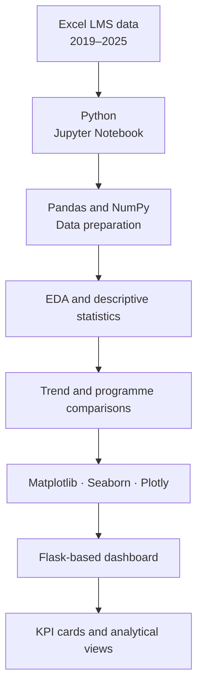

# High-Level Solution Architecture

This diagram describes the project workflow at a conceptual level. It is not a reproduction of internal source code, infrastructure, or deployment details.

## Components

| Component | Role |
|---|---|
| Input | Historical Excel files supplied for the internship work |
| Preparation | Python, Pandas, and NumPy |
| Analysis | EDA, descriptive statistics, time-based trends, and programme comparisons |
| Visualisation | Matplotlib, Seaborn, and Plotly |
| Presentation | Flask web application displaying selected indicators and visualisations |

The architecture intentionally excludes company-specific data models, internal infrastructure, endpoints, deployment configuration, and sensitive implementation details.
